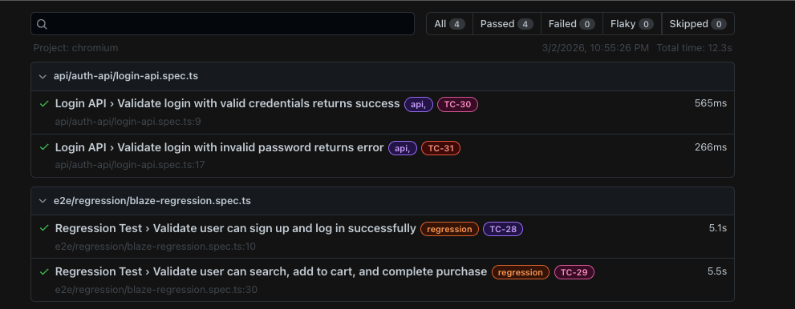
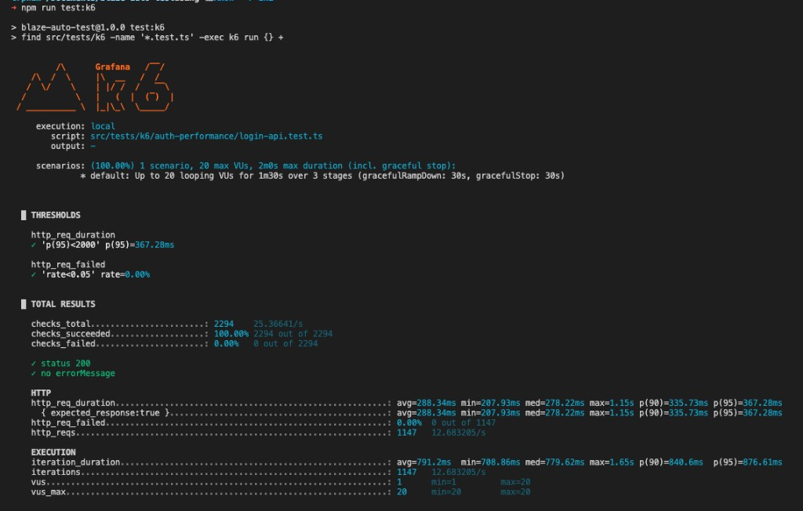

# Blaze Auto Test

Playwright (E2E + API) and K6 performance tests for Demo Blaze.

## Folder layout

```
blaze-auto-test/
├── playwright.config.ts    # Playwright config (testDir: src/tests, testIgnore: k6)
├── tsconfig.json
├── package.json
│
└── src/
    ├── common/             # Shared: config, fixtures, base page
    │   ├── config/env.ts   # Env and config
    │   ├── fixtures/base-test.ts
    │   └── page/BasePage.ts
    │
    ├── pages/              # Page objects
    ├── utils/              # API auth, data helper, logger
    ├── types/
    │
    └── tests/
        ├── testData/testData.ts       # Shared data (dev/staging, env overrides)
        ├── api/                       # API tests (Playwright request)
        │   ├── auth-api/
        │   │   ├── request/           # API request helpers
        │   │   └── login-api.spec.ts
        │   └── other/                 # More API modules
        ├── e2e/                       # E2E tests 
        │   ├── regression/
        │   │   └── blaze-regression.spec.ts
        │   └── other/                 # More E2E suites
        └── k6/                        # Performance tests (K6)
            ├── tsconfig.json          # K6 types
            ├── auth-performance/
            │   └── login-api.test.ts
            └── other/                 # More K6 scripts
```

- **E2E**: `tests/e2e/regression/` - full browser flows (sign up, login, search, cart, place order). Login via API helper, then run UI steps.
- **API**: `tests/api/auth-api/` - HTTP API checks. Request helpers live in `request/`, specs next to them.
- **Performance tests (K6)**: `tests/k6/auth-performance/` - K6 performance tests. Run with `k6 run`.

**Note - K6:** K6 is a different tool from Playwright. Files under `src/tests/k6/` are **not** run by Playwright (Playwright skips that folder). Install K6 on your machine and run those tests with `npm run test:k6`. Use `npm run k6:type-check` to check K6 script types (uses `k6/tsconfig.json`).

## Setup

```bash
npm install
npx playwright install
```

Install [K6](https://grafana.com/docs/k6/latest/set-up/install-k6/) to run performance tests.

## Config

Set these in your shell or in a `.env` file when you want to change the defaults:

| Variable | What it does |
|----------|----------------|
| `USERNAME` | Login username (E2E, API, K6). |
| `PASSWORD` | Login password. |
| `BASE_URL` | API base URL. Playwright gets the browser URL from this. |
| `API_LOGIN_PATH` | Path for the login API (`/login`). |
| `ENV` | `dev` = use defaults from code. `staging` = use values from env. |

## Run tests

### E2E 

```bash
npm test                    # All Playwright tests (E2E + API), chromium
npm run test -- src/tests/e2e/regression   # E2E only
npm run test:firefox
npm run test:webkit
npm run test:ui             # Playwright UI mode
npm run test:headed         # Show browser window
```

### API 

```bash
npm run test -- src/tests/api/auth-api   # API tests only
npm run test -- --grep "Login API"
```

### Performance tests (K6)

You need [K6](https://grafana.com/docs/k6/latest/set-up/install-k6/) installed.

```bash
npm run test:k6             # Run K6 tests locally. No token needed.
npm run k6:cloud            # Optional: stream results to Grafana Cloud (needs token, see below)
npm run k6:type-check       # Check K6 script types
```

Pass user and password via env: `USERNAME=user PASSWORD=pass npm run test:k6`. You don't need a token for local runs, the summary is printed in the terminal. 
If you want a web report, use Grafana Cloud k6 (optional): sign up at [Grafana Cloud](https://grafana.com/products/cloud/) or [k6 Cloud](https://app.k6.io/), create an API token, then run `k6 cloud login --token <TOKEN> --stack <STACK_SLUG>` once, or set env `K6_CLOUD_TOKEN` and `K6_CLOUD_STACK_ID`. After that, `npm run k6:cloud` prints a URL to open the report in the browser.

### Other

```bash
npm run lint                # Check TypeScript
npm run report              # Open last Playwright HTML report
npm run test:junit          # Run tests and write JUnit XML (playwright-report/junit.xml)
```

## Report

- **Playwright** — After tests, HTML report is in `playwright-report/`. Run `npm run report` to open it. JUnit: in CI it is always written to `playwright-report/junit.xml`. Locally, run `npm run test:junit` or set `REPORT_JUNIT=1` when running tests. Set `REPORT_JSON=1` to also write `playwright-report/results.json`.
- **K6** — Summary is printed in the terminal (no token needed). Optional: if you have a Grafana Cloud or k6 Cloud account and API token, run `npm run k6:cloud` to stream results and get a URL to view the report in the browser. To save JSON locally: `k6 run --out json=report.json src/tests/k6/auth-performance/login-api.test.ts`.

## Results

**Playwright (chromium) — 4 passed**

- Login API: valid credentials, invalid password
- E2E Regression: sign up and log in, search + cart + place order
- run `npm test` then `npm run report`


**K6 login API — thresholds ok**

- 20 VUs, 3 stages (1m30s), 1147 iterations
- `http_req_duration` p(95) &lt; 2000 ms, `http_req_failed` rate &lt; 5%
- npm run test:k6


## CI/CD (GitHub Actions)

Workflow file: `.github/workflows/ci.yml`. Runs on every push and pull request to `main`.

1. **Lint** — Check TypeScript. Uses Node 18, `npm ci`, then `npm run lint`.
2. **Test** — Runs after lint passes. For each browser (Chromium, Firefox, WebKit):
   - Install deps and Playwright browsers
   - Run all Playwright tests (`npx playwright test --project=<browser>`)
   - Upload the HTML report as an artifact (`playwright-report-<browser>`)
   - Publish JUnit test results so you can see pass/fail in the GitHub UI
3. **Deploy (CD)** — Runs only when code is **merged to `main`** (push to `main`). Runs after all test jobs pass. Add your deploy steps in the workflow (e.g. deploy app, publish report).

CI uses `BASE_URL=https://api.demoblaze.com` and `TIMEOUT=30000`. K6 performance tests are not run in CI (run them locally with `npm run test:k6` if needed).
